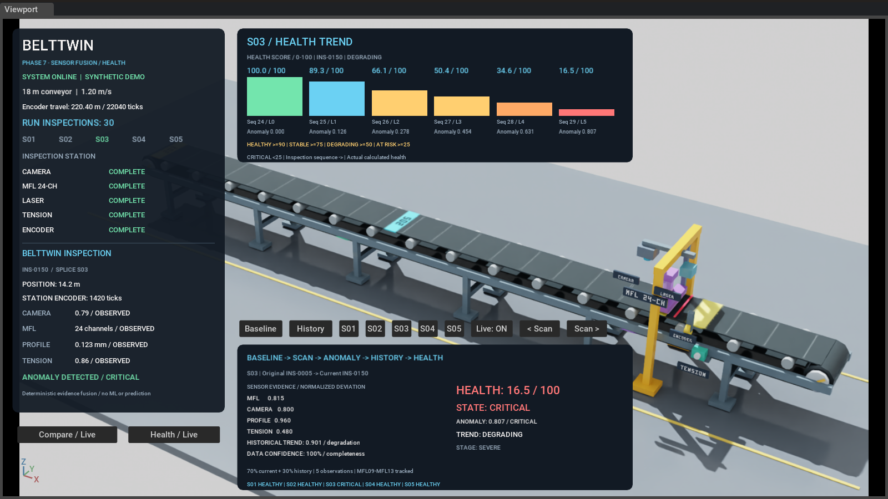
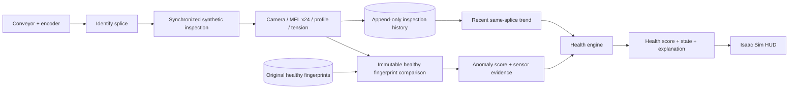

# BeltTwin

### Simulation-first conveyor splice health monitoring

BeltTwin is an SIH prototype built with **NVIDIA Isaac Sim, OpenUSD and Python**.
It follows individual belt splices through inspection, remembers their original
healthy fingerprints, measures change over time, and produces an explainable
health state from current sensor evidence and inspection history.

**Verified locally:** 76 automated tests · 7 implemented phases · 5 tracked splices ·
24 MFL channels · 23.78 FPS in the latest visible Phase 7 acceptance run.



> This is a working software simulation with deterministic synthetic sensor
> observations. It does not claim trained ML/PINN models, an F1 benchmark,
> real electromagnetic inspection, hardware validation or remaining-life prediction.

## What the prototype demonstrates

- An 18 m conveyor with five visible splices, S01–S05, and encoder-based identity.
- Synchronized synthetic camera, 24-channel magnetic, profile and tension observations.
- One immutable healthy Digital Fingerprint per splice.
- Persistent inspection history with unique IDs and chronological sequence numbers.
- Deterministic current-versus-baseline anomaly detection with channel-level evidence.
- Six controlled S03 degradation levels; the other four splices remain healthy.
- A separate health engine combining current condition with recent historical evidence.
- A native Isaac Sim HUD showing the original baseline, current scan, history and health.

## Computational architecture



The baseline is the **original healthy fingerprint**, not the previous scan.
Raw observations, anomaly results and health snapshots remain distinguishable.
The detector owns the sensor weights; the health engine consumes its outputs.

## Run the live demonstration

Tested environment: Windows, Isaac Sim **6.1.0-rc26**, bundled Python **3.12.13**,
RTX 4060 Laptop GPU with 8 GB VRAM. The launcher expects Isaac Sim at
`C:\Isaac Sim`; custom code and generated outputs stay in this project.
No extra Python packages are required.

```powershell
git clone https://github.com/aditays291-max/BeltTwin.git C:\BeltTwin
Set-Location C:\BeltTwin
& .\scripts\run_isaac.ps1 phase7_scene.py --seconds 187 *> data/phase7_run.log
```

Use a different empty destination if `C:\BeltTwin` already exists. Leave the
window open and visible until it exits automatically. The run includes six S03
passages; wall-clock duration is longer than simulated duration because the
simulation advances by 1/30 second per rendered loop iteration.

Every new run intentionally appends inspection records and creates new health
snapshots. Its demonstration scenario starts at healthy level 0; history is never
reset. Earlier phases remain runnable with `phase1_scene.py` through
`phase6_scene.py`. Exported USD files provide the initial scene; Python supplies
live motion, inspection and analysis.

## Verified S03 progression

The same Phase 6 sensor changes flow through the unchanged Phase 5 detector and
the Phase 7 health engine. Neither anomaly severity nor health state is assigned
from the degradation level.

| Level | Anomaly | Health / 100 | Health state | Trend |
|---:|---:|---:|---|---|
| 0 | 0.000 | 100.00 | HEALTHY | STABLE / insufficient history |
| 1 | 0.126 | 89.28 | STABLE | STABLE / insufficient history |
| 2 | 0.278 | 66.13 | DEGRADING | DEGRADING |
| 3 | 0.454 | 50.43 | DEGRADING | DEGRADING |
| 4 | 0.631 | 34.62 | AT RISK | DEGRADING |
| 5 | 0.807 | 16.47 | CRITICAL | DEGRADING |

At the final Phase 7 inspection, S01/S02/S04/S05 each remain approximately
**98.64 / 100, HEALTHY, with STABLE trends**. S03's changed magnetic region is
**MFL09–MFL13**. Final normalized deviations are MFL **0.815**, camera **0.800**,
profile **0.960**, and tension **0.480**.

## Explainable scoring

The anomaly detector uses normalized deviations:

```text
anomaly = 0.50 × MFL + 0.20 × camera + 0.20 × profile + 0.10 × tension
health  = 100 × [0.70 × (1 − anomaly) + 0.30 × (1 − trend_degradation)]
```

The health window contains the current and up to four prior observations of the
same splice in the same demonstration run. It uses mean anomaly for persistence
and a bounded penalty for corroborated rising anomaly. Direction requires at
least three observations and two changes of at least 0.04 in the same direction.
This prevents one isolated jump from establishing a deterioration trend.

| Health score | State |
|---|---|
| 90–100 | HEALTHY |
| 75–<90 | STABLE |
| 50–<75 | DEGRADING |
| 25–<50 | AT RISK |
| 0–<25 | CRITICAL |

Health states are separate from anomaly severity. Data confidence is an
**evidence-completeness rubric**, not a statistical probability. See the
[technical development log](docs/development-log.md) for exact normalization,
trend formulas, thresholds, confidence, schemas and per-phase verification.

## Test and evidence

The deterministic tests need **Windows CPython 3.12+**, without Isaac Sim, a GPU,
or third-party Python packages:

```powershell
python -B -S scripts/run_tests.py
```

Or use the existing bundled interpreter:

```powershell
& 'C:\Isaac Sim\kit\python\python.exe' -B -S scripts\run_tests.py
```

The test runner uses disposable copies. Git does not preserve filesystem mtimes,
so it restores recorded timestamps only on copied baseline fixtures after checking
their hashes; it never edits the real baseline or history. The original 76 tests
run unchanged. Git attributes preserve byte-level audit data and protected source
files. A Windows GitHub Actions workflow runs this same suite on push and PR.

- [Phase 7 acceptance report](data/phase7_acceptance.json)
- [Phase 6 acceptance report](data/phase6_acceptance.json)
- [Baseline fingerprints](data/baseline/)
- [Raw inspection history](data/history/)
- [Health snapshots](data/health/)
- [Health trend screenshot](docs/images/phase7_hud_health_trend.png)
- [Sensor fusion screenshot](docs/images/phase7_hud_sensor_fusion.png)

The latest local acceptance preserves every original baseline hash and mtime,
all 85 pre-Phase-7 history records, and all 24 MFL channels. Phase 1–6 live
regressions passed. The scene remains 260 primitives, identical to Phase 6.
The performance reference is approximately 21 FPS; the measured 23.78 FPS is a
single local run, not a hardware-independent guarantee.

## Repository layout

```text
scripts/        Scene entry points, sensor generators, tracking, stores and tests
project/        Lightweight Kit configuration and initial USD scenes
data/baseline/  Immutable original healthy fingerprints
data/history/   Persisted raw inspections
data/degradation/  Per-run anomaly progression references
data/health/    Immutable derived health snapshots
docs/          Technical record, contribution guide and actual screenshots
screenshots/   Locally generated captures (not committed)
```

Runtime caches, lock files, environment secrets and generated runtime logs are
excluded from version control. NVIDIA Isaac Sim itself is not redistributed.

## Scope and next steps

| Implemented and verified | Future work / not implemented |
|---|---|
| Synthetic multi-sensor inspection | Calibrated physical sensors and hardware trials |
| Fingerprints, history and anomaly comparison | Real electromagnetic / magnetic NDT modelling |
| Progressive degradation and deterministic health | Trained vision/ML/PINN models and measured F1 benchmarks |
| Native Isaac Sim demonstration HUD | Industrial PLC/SCADA, ROS 2, MQTT and external databases |
| Explainable current/history fusion | RUL prediction, maintenance agents and work orders |

Concept diagrams may describe a future system. Only the implemented column and
linked acceptance evidence describe the current prototype. Known nonblocking
Isaac startup warnings concern the crash reporter, MaterialX and skipped
integrated GPU; details are retained in the technical log.

**Phase 7 complete. Phase 8 not started.**
